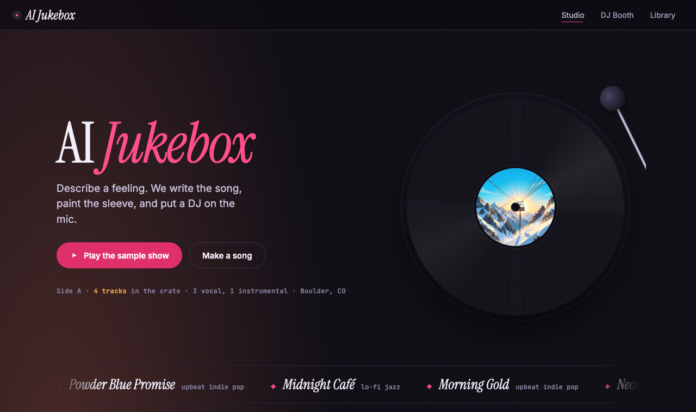
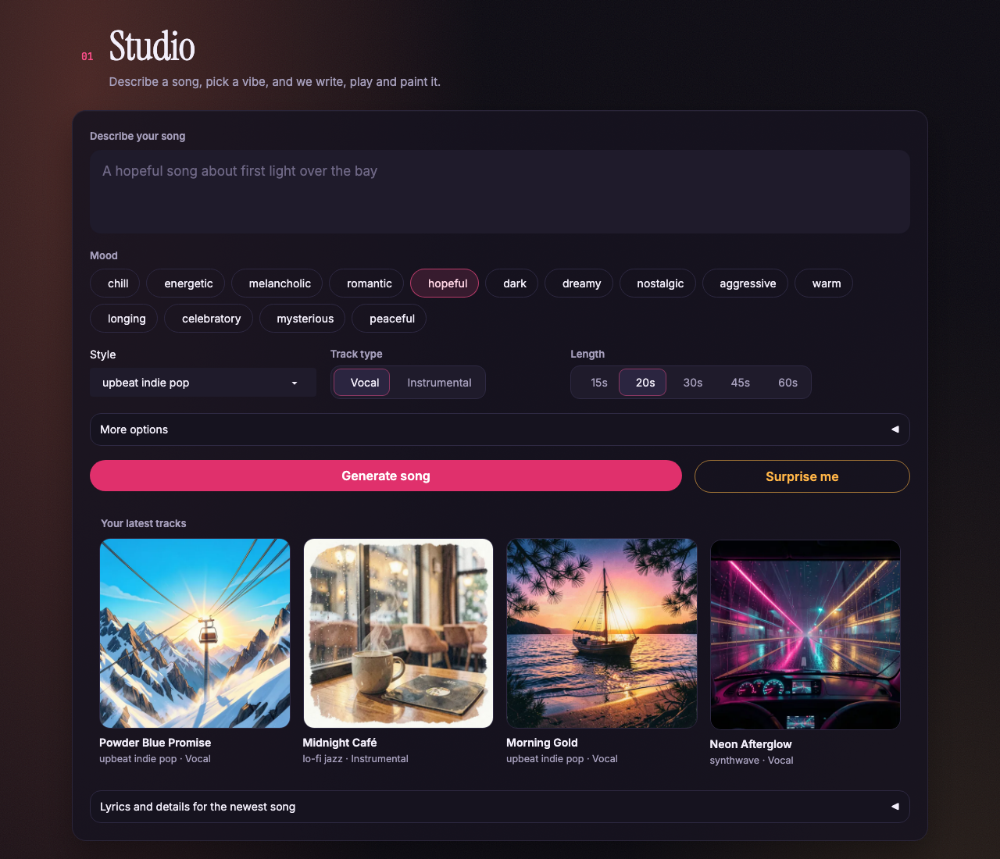
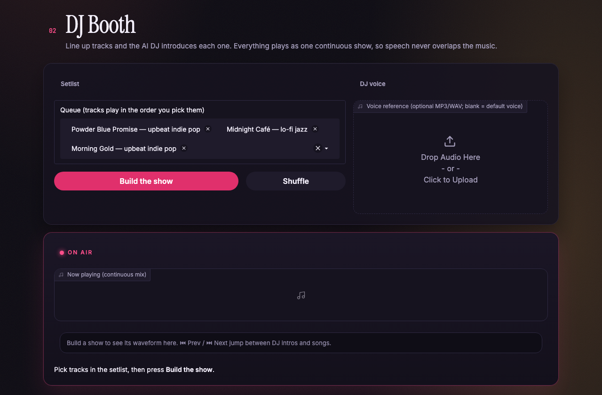
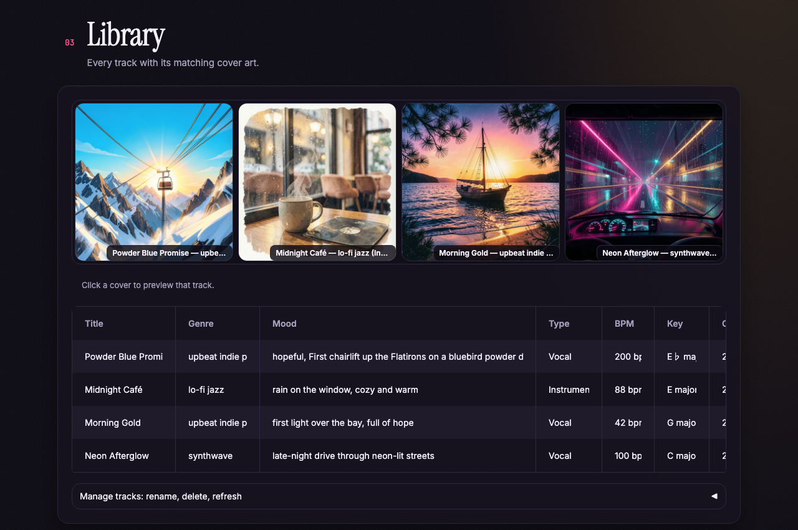

# AI Jukebox

Create vocal or instrumental songs with matching cover art, then arrange them into a continuous show with spoken DJ introductions. All AI generation uses the supplied class services.

## Live demo

[Open AI Jukebox](https://619e96e27bedb9d84c.gradio.live/)

This temporary Gradio link runs from a teammate's Mac, so it only works while that Mac is awake and the app process is running, and it expires after about one week. Restart with `AIJ_SHARE=1 python app.py` and update this link when needed. Visitors share one library. The downloadable app is the version to submit for independent testing.

## Features and controls

The app is one page with a fixed top bar that jumps to its three areas: **Studio**, **DJ Booth** and **Library**. The hero at the top has a turntable whose label is the newest cover, a **Play the sample show** button, and a scrolling ticker of every track in the library.

1. **Studio (make a song):**
   - **Describe your song** in your own words; the description becomes the song's theme for the lyrics, title and cover prompts.
   - Pick any number of **Mood** chips, a **Style**, **Vocal** or **Instrumental**, and a **Length** of 15, 20, 30, 45 or 60 seconds.
   - **More options** holds the title, vocal style, energy, tempo (0 = automatic, up to 220 BPM), key, time signature, music planning and custom lyrics. Leave the title blank and Qwen names the song; leave the lyrics blank on a vocal track and Qwen writes them.
   - **Generate song** locks while it runs. A status card in **Your latest tracks** shows each step (writing lyrics, writing music, painting the cover, "step N of 3") and becomes the finished track card with its cover. If a request fails, an error card explains why and the button is ready to retry.
   - Click any track card to play it in the **Now previewing** player. Lyrics and the production log for the newest song are under **Lyrics and details for the newest song**.
   - **Surprise me** fills in a random description and settings; it does not generate audio until you press **Generate song**.
2. **DJ Booth (AI DJ show):**
   - The setlist starts with the three most recent tracks (the three samples on a fresh install), and every new song is added to the end. Tracks play in the order you pick them; **Shuffle** randomizes the order.
   - Optionally upload an MP3 or WAV **DJ voice** reference; leave it blank for the default Chatterbox voice.
   - **Build the show** writes and speaks song-specific introductions, then mixes intros and songs into one continuous WAV, so speech never overlaps music. The **On air** panel shows the covers, the player (play/pause and seek), a waveform with cue markers, **Prev / Next** to jump between DJ intros and songs, and a cue list with start times. Press play if the browser blocks autoplay.
3. **Library:** every track's cover and metadata. Click a cover to preview the track. **Manage tracks** renames, deletes or refreshes tracks. Newly generated tracks persist in the local library.

While anything plays, the page reacts: the turntable spins up and the tonearm drops, the background lighting pulses faster, and a **Playing** badge appears in the top bar. All animation is turned off for visitors who set "reduce motion" in their operating system. **Music planning** enables the music service's planning option and may increase generation time; improved quality is not guaranteed. Musical settings are requests to the model; exact musical adherence is not guaranteed.

Three generated samples ship with the app: **Neon Afterglow**, **Morning Gold**, and **Midnight Café**. Press **Play the sample show**, then **Build the show**, to hear them with DJ introductions. The two vocal samples have AI-generated lyrics; Midnight Café is instrumental. `scripts/generate_samples.py` documents their generation through the class pipeline. The sample audio, artwork and metadata are included under `samples/` and copied into an empty library on first launch.

## Screenshots

Captured November 1, 2026 from the version in this repository (desktop width).

| Hero and track ticker | Studio |
| --- | --- |
|  |  |

| DJ Booth | Library |
| --- | --- |
|  |  |

## Setup and use

Requirements: **Python 3.10+**, pip, network access to the class services, and the class API key. `requirements.txt` lists Gradio, python-dotenv, miniaudio, Pillow (cover thumbnails) and pytest. Audio mixing runs in-process; ffmpeg is not required. Windows setup has a launcher but was not retested in this review.

From the extracted repository directory:

```bash
python3 -m venv .venv
source .venv/bin/activate            # Windows: .venv\Scripts\activate
pip install -r requirements.txt
cp .env.example .env                # Windows: copy .env.example .env
```

Edit `.env` and replace `AIJ_API_KEY=<your-class-key>` with the supplied class key. Keep the file private. The UI can open without a valid key, but generation requests need one.

```bash
python app.py                       # http://127.0.0.1:7860
# If that port is busy:
AIJ_PORT=7861 python app.py
# Optional temporary public link:
AIJ_PORT=7861 AIJ_SHARE=1 python app.py
```

On Windows, set environment variables using `set AIJ_PORT=7861` and `set AIJ_SHARE=1` before launching. The convenience launchers `bash run.sh` and `run.bat` create a virtual environment and install dependencies when no `.venv` exists, and copy `.env.example` to `.env` when needed. Fill in the key before generating.

Configuration example (placeholders only):

```dotenv
AIJ_BASE_HOST=http://dobolyi.com
AIJ_API_KEY=<your-class-key>
AIJ_LLM_PORT=9001
AIJ_IMAGE_PORT=9006
AIJ_MUSIC_PORT=9007
AIJ_TTS_PORT=9008
AIJ_DATA_DIR=
```

An empty `AIJ_DATA_DIR` uses the repository's gitignored `data/` directory.

| Required service | Port | Model | Request format |
| --- | --- | --- | --- |
| Text: lyrics, artwork prompts, DJ scripts | 9001 | cyankiwi/Qwen3.6-35B-A3B-AWQ-4bit | `/v1/chat/completions` |
| Cover art | 9006 | black-forest-labs/FLUX.2-klein-4B | `/v1/images/generations` |
| Music | 9007 | ACE-Step/acestep-v15-xl-turbo | `/release_task`, poll `/query_result`, download audio |
| DJ speech | 9008 | Chatterbox Multilingual V3 (`chatterbox-v3`) | `/v1/audio/speech` |

Port 9000 is reserved for Hermes and is rejected by the app's service URL builder. No paid AI service is used. Credentials stay in server-side request headers. Never commit `.env`, user uploads or reference recordings. Gradio may store uploads in its temporary cache; generated media and library records use `data/`. Neither belongs in the submitted ZIP.

## Test results - November 1, 2026

Run `python -m pytest -q`. The suite has **65 passing tests**, including queue ordering, immediate library-table updates, blank storage defaults, reserved-port protection, waveform amplitude/timing, the live generation status card and error card, automatic song titles, new songs joining the setlist, and cover thumbnails. These unit tests use mocked class services; they do not establish live service availability.

The separate live run recorded in [`scripts/evidence_output.json`](scripts/evidence_output.json) used the configured class credentials. Audio files were also decoded to check validity and duration. These requests went through the generation pipeline directly, so the 12- and 10-second lengths predate the redesigned Length buttons (15-60 seconds).

| Test input | Expected | Actual result |
| --- | --- | --- |
| Golden Hour; chillhop; warm sunset/easygoing; vocal; 12 seconds | AI lyrics, playable song saved in library | 124 words; 192,812-byte MP3; decoded duration 12.00 seconds |
| Empty Streets; ambient; quiet rainfall; instrumental; 10 seconds | No lyrics; playable instrumental | Empty lyrics; INSTRUMENTAL mode; decoded duration 10.00 seconds |
| Generate covers for both songs | New FLUX image for each song | Both have valid PNG files; Golden Hour is 1024 x 1024 |
| Build a two-song show; default voice | Song-specific Qwen scripts, Chatterbox speech, sequential mix | Two intros; four segments; 44.1-second WAV; cues 0.00 / 12.03 / 24.38 / 34.09 seconds |
| MP3 reference sent through the voice-reference client | Speech response using reference input | 45-word script; 177,836-byte MP3; perceived similarity not evaluated |
| Deliberately wrong API key | Readable rejection | HTTP 401 with an invalid-key message |
| Restore correct key and retry speech | Request succeeds | 24,236-byte speech response |

The evidence file also retains an explicitly dated October 19 LLM token-budget investigation. It is historical evidence, not a newly reproduced failure. The client retries empty text responses with a larger bounded token budget, and unit tests cover that behavior.

**Live run after the redesign (November 1, 2026, class credentials):**

| Test input | Expected | Actual result |
| --- | --- | --- |
| Studio: "First chairlift up the Flatirons on a bluebird powder day"; hopeful; upbeat indie pop; vocal; 15 s; title left blank | Status card shows each step; AI title and lyrics; playable song; cover added; song joins setlist | Card showed lyrics (about 32 s), cover idea, music, then cover; Qwen titled it "Powder Blue Promise"; 15 s track; FLUX cover of a chairlift over snowy peaks; added to library, grid and setlist; about 70 s total |
| Instrumental; lo-fi hip hop; calm, rainy evening; 10 s (pipeline call) | No lyrics; playable audio; cover | INSTRUMENTAL mode, no lyrics; 10.0 s decoded audio; cover saved; 25 s |
| DJ Booth: build a four-track show (three samples plus the new song); default voice | Four song-specific intros; one mix with no overlap; Prev/Next cues | Four intros and four songs; 1:41 continuous mix with cues at 0:00, 0:08, 0:24, 0:35, 0:51, 0:59, 1:15, 1:25; about 85 s to build |
| Custom DJ voice from an MP3 reference and from a WAV reference (Chatterbox output used as the reference) | Speech returned for both formats | 2.6 s and 3.0 s of speech returned; perceived similarity not evaluated |
| Generate without a configured key | Readable error, nothing saved, button usable again | Error card plus message naming the missing `AIJ_API_KEY`; button unlocked |
| Fresh copy of the committed files only (no `.env`, no `data/`), new virtual environment | Installs, tests pass, samples load | Dependencies installed; 65/65 tests passed; three samples with audio, covers and AI lyrics loaded |

**Deployment checks:** a GitHub ZIP was extracted separately, dependencies installed in a fresh virtual environment, and the app booted with three bundled samples. See the [rubric audit](docs/rubric-audit.md) for scope and remaining team requirements.

**Fixes from review:** selected queue order is preserved; new songs immediately update the library table; blank storage settings use `data/`; waveform peaks use signed samples and cue markers use actual show duration. Skip controls now target Gradio's active player inside its shadow DOM instead of an unused audio element. The placeholder key and reserved agent port are rejected before requests.

**Still unchecked:** a full browser listening pass, sung pronunciation, perceived voice-clone similarity, a WAV upload through the browser (the WAV reference was checked through the speech client), long-duration reliability, and a teammate's independent installation from the GitHub ZIP of the submitted commit. Automated decoding and API success do not prove those items. The final Next-button browser check moved the active player and visible time to the expected cue. A complete Previous-button recheck was interrupted when the browser tab became unavailable; full playback listening remains a team check.

## Design judgment

The show is mixed into **one continuous WAV** instead of starting separate speech and song players. The live test produced four sequential segments over 44.1 seconds, with 0.35-second gaps and no simultaneous segments. This makes automatic sequencing a property of the audio file. The tradeoff is WAV storage (about 10.6 MB per minute for 44.1 kHz, stereo, 16-bit audio) and having to rebuild the show after changing the queue.

Generation shows **live progress in the track grid** instead of a single spinner. In the live run, writing lyrics alone took about 32 of the roughly 70 seconds; a status card that names each step ("Writing lyrics… step 1 of 3") and then turns into the finished track tells the user the app is working and what it is waiting for, and an error card in the same place shows what failed. The page uses a dark theme with one pink accent; button text is white on `#E0306C` (about 5.5:1 contrast), narrow screens stack the controls, and every animation is disabled for visitors who request reduced motion. These are design choices; user preference and accessibility beyond the checks described here have not been formally measured.

The historical empty-response investigation showed that a successful HTTP response could still contain no lyrics. The practical lesson was to check the returned content and retry within a limit, rather than treating a successful request as a finished feature.

## Known limitations

- Class-service load can cause timeouts. ACE-Step polling has a seven-minute deadline, and generation may be retried after an error.
- A failed cover request preserves the audio and reports a warning. There is no cover-only retry button; generating again retries the full flow.
- Voice and musical qualities depend on the models; input settings do not guarantee exact output.
- The public link is temporary and depends on the host process.
- The turntable label and the track count in the hero update when the page is reloaded, not the moment a song finishes (the ticker, track grid and setlist update immediately). The live status card says "New song" until the song is saved, because Qwen names it during generation.
- The app is a shared class demo: public visitors use the same library and can modify it. It has no separate user accounts.

## Submission and team verification

Submit the shared repository URL, the exact commit ID and a ZIP **downloaded from GitHub for that same commit**. Have a teammate extract it, follow these instructions with only class credentials, and test all three core features. Keep the repository accessible through grading.

Use the [team checklist](scripts/verification_checklist.md) to record what was actually completed. At the initial audit there were no GitHub issues or pull requests; two contributor accounts do not prove that every teammate contributed or reviewed a teammate. The team must document that work and explain its findings in its own words. The original build prompt/Hermes conversation was not available for this review.

For a local packaging check, `python scripts/make_zip.py` builds `dist/ai-jukebox-submission.zip` and `python scripts/make_zip.py --check` audits excluded runtime paths. This development archive does not replace the required GitHub download.

## Decision Judgement

**Jaxon:**

> My first jazz song was honestly a banger. It was something I'd actually listen to, which made me want to keep trying different genres and moods to see what else I could make. Having its own cover art and a DJ introduce it made it even cooler. That first song was what got me excited about the project.

**Jameson:**

> Our first site worked, but it looked like every other AI-generated page, so we focused on making it feel like an actual jukebox. We switched to a dark theme with a turntable that spins up when music plays, cut song creation down to one "describe your song" box with mood chips, and added a live status card so you can see what step your song is on instead of waiting on a spinner. My favorite part is the background pulsing like a nightclub while a song plays. It makes the whole thing feel alive.

**Seamus:**

> My favorite part of playing with the jukebox was how little musical knowledge you need to get started. You can describe a vibe and let the AI handle the song, lyrics and cover art. I thought the DJ introductions were a cool touch as well because they tie the tracks together like a radio host would. I also think it’s a little scary how closely AI can match what you had in your head from a simple description. It reminded me of how music algorithms feed you songs they think you’ll like without you specifically searching for them. You still choose what to play, but it makes you wonder how much of your taste is your own and how much is shaped by what keeps getting put in front of you.
