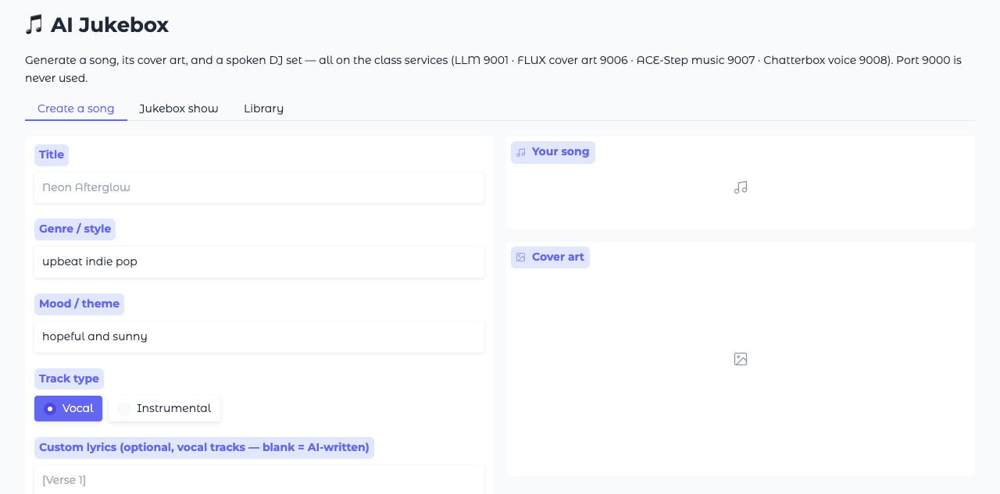
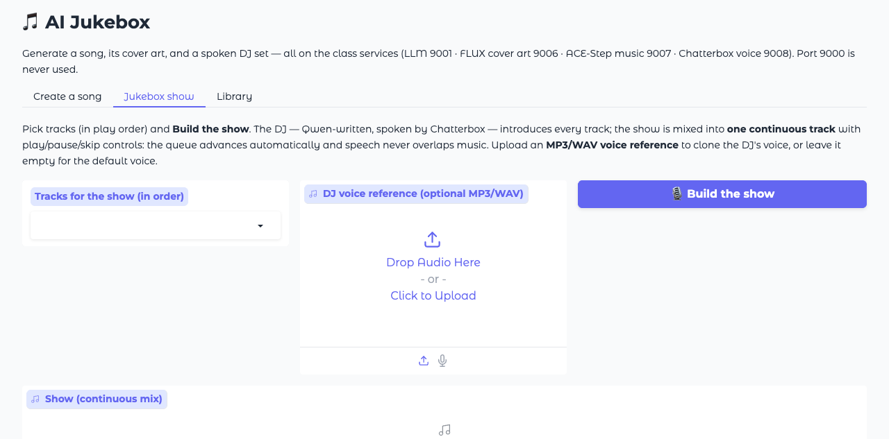
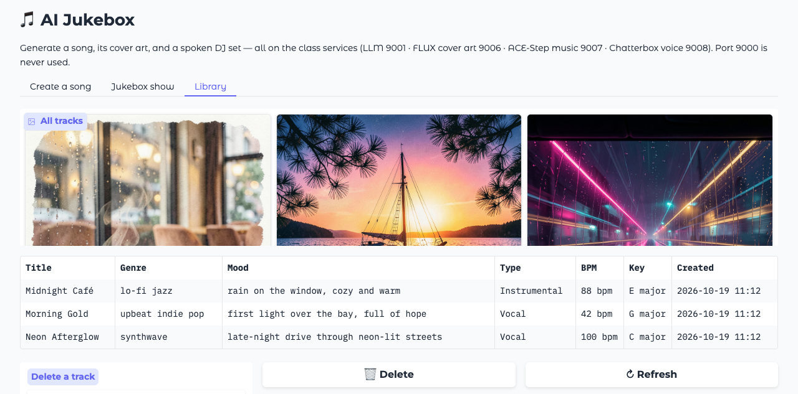

# 🎵 AI Jukebox

Generate a **song**, its **cover art**, and a full **jukebox show with a spoken DJ**
— every AI feature runs on the class model services (`dobolyi.com` ports
9001 / 9006 / 9007 / 9008, see `class-endpoints.txt`). Port 9000 is reserved
for agentic use and is **never** used by this app.

## Live demo

🔗 **https://c9682abe2ba88d99f4.gradio.live** — the app currently running.

> Share links rotate: this public URL dies with the app process and expires
> automatically (~1 week). When it stops working, refresh it by launching
> `AIJ_SHARE=1 python app.py` on the host machine and replacing this URL with
> the new `gradio.live` link. The local Setup and use below always works.

## Features

1. **Customizable song generation** — choose style, mood, length, and **vocal or
   instrumental**. Vocal tracks get AI-written lyrics (class LLM, 9001) or your
   own; **ACE-Step 1.5 XL Turbo** (9007) renders playable MP3 audio, added to the
   library.
2. **Matching cover art** — the LLM turns each song into an album-art prompt and
   **FLUX.2-klein-4B** (9006) paints a 1024×1024 cover, displayed with the track.
3. **Integrated AI DJ** — pick tracks (in queue order), optionally upload an
   **MP3/WAV voice reference** to clone the DJ's voice (or keep the default), and
   build a show. The DJ — **Qwen-written** (9001), **Chatterbox-spoken** (9008) —
   introduces every track; the show is **mixed into one continuous track** with
   native play/pause/skip controls: the queue advances automatically and speech
   never overlaps music.

Three pre-generated sample tracks (titles + covers, AI-written lyrics only)
ship under `samples/` and are loaded into the library on first run so the app
is playable the moment it starts.

## Screenshots

| Create a song | Jukebox show | Library |
| --- | --- | --- |
|  |  |  |

Left: form for title / genre / mood / track type (vocal|instrumental) / lyrics / duration.
Middle: track queue picker, optional DJ voice-reference upload, “Build the show”.
Right: covers gallery + track table (the three bundled sample tracks are shown).

## Service map

| Port | Model (per class-endpoints.txt) | Used for | API |
| --- | --- | --- | --- |
| 9001 | `cyankiwi/Qwen3.6-35B-A3B-AWQ-4bit` | lyrics, cover prompt, DJ script | vLLM `/v1/chat/completions` |
| 9006 | `black-forest-labs/FLUX.2-klein-4B` | cover art | vLLM-Omni `/v1/images/generations` |
| 9007 | `ACE-Step/acestep-v15-xl-turbo` | music (async task API) | `release_task` → poll → download |
| 9008 | Chatterbox Multilingual V3 | DJ voice (default or cloned) | `/v1/audio/speech` |

## Setup and use

**Dependencies:** Python 3.10+, `pip install -r requirements.txt`
(`gradio`, `python-dotenv`, `miniaudio`). **No additional software** — mixing is
done in-process (miniaudio decodes MP3/WAV; stdlib writes WAV; **ffmpeg is not
required**).

**Endpoint configuration** (`.env.example`, no credentials):

```bash
AIJ_BASE_HOST=http://dobolyi.com     # class service network
AIJ_API_KEY=<your-class-key>         # from class-endpoints.txt — NEVER commit
AIJ_LLM_PORT=9001                    # Qwen text LLM
AIJ_IMAGE_PORT=9006                  # FLUX cover art
AIJ_MUSIC_PORT=9007                  # ACE-Step music
AIJ_TTS_PORT=9008                    # Chatterbox voice
AIJ_DATA_DIR=                        # default: ./data (gitignored)
```

**Supplying credentials securely:** copy `.env.example` → `.env` and fill in
`AIJ_API_KEY` with the class key. `.env` is gitignored; the app refuses to make
requests until a key is set, and no key ever appears in code, docs, logs, or
GitHub. Keep `.env` and `data/` out of any submission archive too.

**Launch:**

```bash
python3 -m venv .venv && source .venv/bin/activate
pip install -r requirements.txt
cp .env.example .env                 # fill AIJ_API_KEY
python app.py                        # http://127.0.0.1:7860 (Gradio picks the
                                     # next free port if 7860 is busy)
# optional public link: AIJ_SHARE=1 python app.py
```

**Exercising the three core features:**

1. **Custom song** — *Create a song* tab: title + genre + mood, choose
   **Vocal** (AI lyrics) or **Instrumental**, set duration → *Generate* →
   playable MP3 + lyrics + production log; the track joins the library.
2. **Cover art** — generated automatically with every song; verify it in the
   right-hand preview and in the Library gallery, captioned with its track.
3. **AI DJ** — *Jukebox show* tab: use **Play** on the samples or generate your
   own first. Select tracks in order, optionally upload an **MP3/WAV voice
   reference** (blank = default voice) → *Build the show* → play the single
   continuous mix: DJ speech between every track, cue sheet with times, covers
   for each queued track.

## Test results

**Unit tests** (no network — every class service mocked): 43 passing,
`python -m pytest -q`, run in CI on push.

**Live end-to-end evidence** (run 2026-10-19 against the real class endpoints;
inputs / expected / actual recorded by `scripts/e2e_evidence.py`, full JSON in
`scripts/evidence_output.json`):

| # | Feature | Input | Expected | Actual result | Status |
| --- | --- | --- | --- | --- | --- |
| 1a | Vocal song | “Golden Hour” chillhop, 12 s | playable MP3, AI lyrics, metadata | 128-word lyrics; 192,812 B MP3 (ID3); 88 bpm, E major; music step 5.8 s | ✅ PASS |
| 1b | Instrumental | “Empty Streets” ambient, 10 s, vocal=off | no lyrics sent | 0 lyric chars; mode INSTRUMENTAL | ✅ PASS |
| 2 | Cover art | Golden Hour (LLM cover prompt) | new FLUX cover with the track | cover.png exists, **1024×1024** | ✅ PASS |
| 3a | DJ show | 2 tracks, **default voice** | Qwen script + Chatterbox speech between songs, one continuous mix | 2 spoken intros (ID3); 4 segments; cue times 0.0 / 10.35 / 22.70 / 33.25 s; **43.2 s mix** | ✅ PASS |
| 3b | DJ voice clone | base64 MP3 reference (as the UI upload sends) | intro in uploaded voice | 36-word script; 171,692 B MP3 (ID3) | ✅ PASS |
| A | Failure: bad key | `AIJ_API_KEY=wrong-key` | understandable error; nothing saved | `HTTP 401 … "Missing or invalid API key."` surfaced as a UI error; recovery = fix `.env`, retry | ✅ PASS |
| B | Failure: LLM budget | `max_tokens=1536` (song lyrics) | non-empty lyrics | `finish_reason=length`, `reasoning_tokens == max_tokens`, content `None` (4/4 attempts) — **investigated and fixed** | 🔧 FIXED |

Case B in full: the Qwen3.6-35B reasoning pass still runs even with
`chat_template_kwargs: {"thinking": false}`. When it consumes the whole token
budget the reply comes back empty — it took a live request (not unit tests) to
surface this. Fix: `chat()` now retries with a doubled budget until content
arrives (capped), and every call site uses a generous budget (lyrics 4096,
cover prompt 2048, DJ script 1024). Regression tests cover both paths.

**Unresolved problems**

- The public share link rotates (~1 week) and dies with the app process; the
  README documents the refresh procedure. A truly permanent URL would need
  infrastructure outside the class constraints (no paid services).
- ACE-Step is an async queue: under class load a task can take longer than the
  7-minute timeout, which raises a readable error (recoverable by retry).
- FLUX covers are ~3.3 MB PNGs (kept full-res for print quality; repo size
  impact ~10 MB for the bundled samples).

**Completed vs. unchecked — clearly separated**

- ✅ Completed & verified: all unit tests; live probes of all four endpoints;
  live E2E of the 3 core features + voice clone + 2 failure cases; app boots
  and the three tabs render (screenshots above, validated visually).
- ⬜ Unchecked: automated browser click-through of the full Create and Show
  flows (exercised via library calls and screenshots, not scripted UI clicks);
  sung-lyrics pronunciation quality (ACE-Step controls vocals; no per-phrase
  control); long-running soak of the share URL; CI results after this push.

## Design judgment

**One important design choice:** the jukebox show is **pre-mixed into one
continuous audio file** (miniaudio decodes every segment to 44.1 kHz stereo
16-bit PCM, gaps are inserted, stdlib `wave` writes one WAV) instead of
queueing separate audio components in the UI with a playback-chain script.

**Why and evidence:** chaining `<audio>` components in Gradio needs browser-side
playback tracking and risks overlap or dead air between segments — exactly what
the requirement forbids. Mixing makes the ordering a property of the file: the
E2E run produced a 43.2 s mix whose cue times (0.0, 10.35, 22.70, 33.25 s)
match the constituent intro/song durations plus 0.35 s gaps to within 0.1 s —
sequential, gapless, no overlap, by construction. The player then gives free
play/pause/skip and the cue sheet tells the listener where each segment starts.
Costs: a WAV file per show (~5 MB/min) and no per-segment hot-swap, both
acceptable for a class-sized library.

**A limitation investigated:** the empty-LLM-reply failure (case B above). We
assumed disabling thinking would bound reply length; live testing showed the
reasoning pass consumes tokens regardless, so requests with modest budgets
silently returned `content: null`. **Lesson:** trust the vendor schema less than
a live probe — instrument real requests (finish_reason, reasoning_tokens) and
make the client degrade gracefully (retry with a larger budget) instead of
failing hard on a model quirk.

## Layout

```
app.py                 Gradio UI (Create / Jukebox / Library)
ai_jukebox/
  config.py            env-driven config (host, ports, models, key)
  http.py              auth'd HTTP helpers (stdlib only)
  llm.py               9001 chat + lyrics/cover/DJ prompt writers (+retry)
  image.py             9006 FLUX cover art
  music.py             9007 ACE-Step async generation
  tts.py               9008 Chatterbox speech (+voice cloning)
  dj.py                show builder: script + spoken intros
  media.py             mixes a show into one continuous WAV (no ffmpeg)
  library.py           on-disk song library + bundled-sample seeding
  pipeline.py          orchestration for one full track
scripts/
  generate_samples.py  regenerates the 3 bundled samples (class endpoints)
  e2e_evidence.py      live end-to-end evidence run (writes evidence_output.json)
tests/                 unit tests with mocked services (43)
docs/screenshots/      UI screenshots used in this report
samples/               bundled pre-generated sample tracks (committed)
```

## Compliance

- No paid services anywhere (core or optional) — class services and the class
  key alone.
- No third-party music, lyrics, cover art, or voice samples are bundled; every
  asset (including the samples) is generated live by the class services, and
  sample lyrics are AI-written.
- User uploads/recordings are never part of this repo — they land in `data/`
  (gitignored); keep them out of commits and submission archives too.
- No credential material in any committed file: `AIJ_API_KEY` is set per
  developer in `.env` (placeholders only in `.env.example` and this README).
