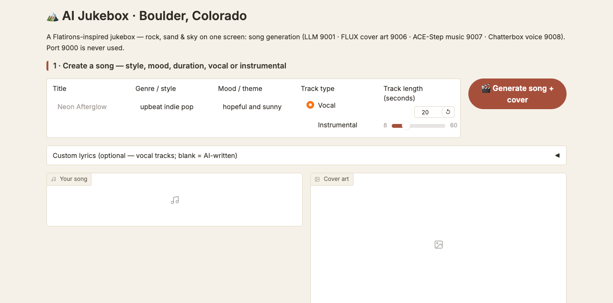
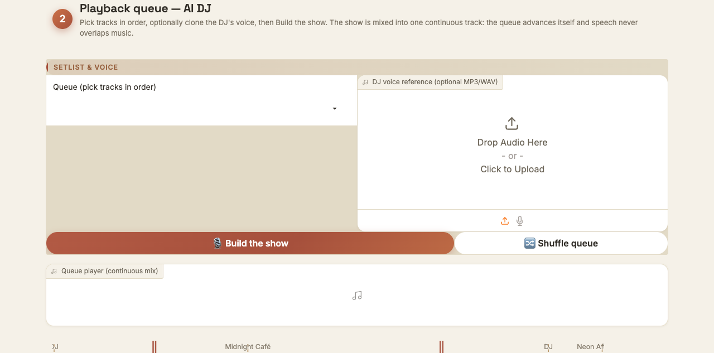
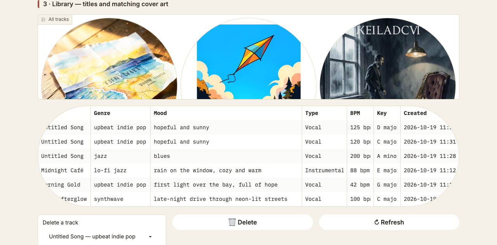

# AI Jukebox

Create vocal or instrumental songs with matching cover art, then arrange them into a continuous show with spoken DJ introductions. All AI generation uses the supplied class services.

## Live demo

[Open AI Jukebox](https://ac393470219442d944.gradio.live/)

This temporary Gradio link requires the host Mac to stay awake and the app process to keep running. It expires after about one week. Restart with `AIJ_SHARE=1 python app.py` and update this link when needed. The downloadable app is the version to submit for independent testing.

## Features and controls

The dashboard has three numbered sections on one page:

1. **Create a song:** enter a title, genre and mood; select Vocal or Instrumental and a length of 8-60 seconds. Optional settings include energy, tempo (0 = automatic; slider up to 220 BPM), key, time signature and vocal style. Blank vocal lyrics are written by Qwen; custom lyrics are also accepted. **Generate song + cover** creates playable audio, requests matching artwork, and updates the library. Musical settings are requests to the model; exact musical adherence is not guaranteed.
2. **Playback queue - AI DJ:** select songs in order and optionally upload an MP3/WAV voice reference. **Build the show** writes and speaks song-specific introductions, then mixes the introductions and songs into one WAV. Press play if the browser blocks autoplay. Native play/pause and the seek bar control playback; **Prev / Next** move between segment cues (DJ intros and songs). **Shuffle queue** changes the order for the next show you build.
3. **Library:** view covers and track metadata, rename or delete a track, and refresh the display. Newly generated tracks persist in the local library.

**Surprise me** fills in random song settings; it does not generate audio until you press **Generate song + cover**. **Music planning** enables the music service's planning option and may increase generation time; improved quality is not guaranteed.

Three generated samples ship with the app: **Neon Afterglow**, **Morning Gold**, and **Midnight Café**. Select them in the queue and build a show to hear them through the player. The two vocal samples have AI-generated lyrics; Midnight Café is instrumental. `scripts/generate_samples.py` documents their generation through the class pipeline. The sample audio, artwork and metadata are included under `samples/` and copied into an empty library on first launch.

## Screenshots

These screenshots show the interface before the latest wording and reliability fixes.

| Create a song | Playback queue | Library |
| --- | --- | --- |
|  |  |  |

## Setup and use

Requirements: **Python 3.10+**, pip, network access to the class services, and the class API key. `requirements.txt` lists Gradio, python-dotenv, miniaudio and pytest. Audio mixing runs in-process; ffmpeg is not required. Windows setup has a launcher but was not retested in this review.

From the extracted repository directory:

```bash
python3 -m venv .venv
source .venv/bin/activate            # Windows: .venv\Scripts\activate
pip install -r requirements.txt
cp .env.example .env                # Windows: copy .env.example .env
```

Edit `.env` and replace `AIJ_API_KEY=<your-class-key>` with the supplied class key. Keep the file private. The UI can open without a valid key, but generation requests need one.

```bash
python app.py                       # http://127.0.0.1:7860
# If that port is busy:
AIJ_PORT=7861 python app.py
# Optional temporary public link:
AIJ_PORT=7861 AIJ_SHARE=1 python app.py
```

On Windows, set environment variables using `set AIJ_PORT=7861` and `set AIJ_SHARE=1` before launching. The convenience launchers `bash run.sh` and `run.bat` create a virtual environment and install dependencies when no `.venv` exists, and copy `.env.example` to `.env` when needed. Fill in the key before generating.

Configuration example (placeholders only):

```dotenv
AIJ_BASE_HOST=http://dobolyi.com
AIJ_API_KEY=<your-class-key>
AIJ_LLM_PORT=9001
AIJ_IMAGE_PORT=9006
AIJ_MUSIC_PORT=9007
AIJ_TTS_PORT=9008
AIJ_DATA_DIR=
```

An empty `AIJ_DATA_DIR` uses the repository's gitignored `data/` directory.

| Required service | Port | Model | Request format |
| --- | --- | --- | --- |
| Text: lyrics, artwork prompts, DJ scripts | 9001 | cyankiwi/Qwen3.6-35B-A3B-AWQ-4bit | `/v1/chat/completions` |
| Cover art | 9006 | black-forest-labs/FLUX.2-klein-4B | `/v1/images/generations` |
| Music | 9007 | ACE-Step/acestep-v15-xl-turbo | `/release_task`, poll `/query_result`, download audio |
| DJ speech | 9008 | Chatterbox Multilingual V3 (`chatterbox-v3`) | `/v1/audio/speech` |

Port 9000 is reserved for Hermes and is rejected by the app's service URL builder. No paid AI service is used. Credentials stay in server-side request headers. Never commit `.env`, user uploads or reference recordings. Gradio may store uploads in its temporary cache; generated media and library records use `data/`. Neither belongs in the submitted ZIP.

## Test results - November 1, 2026

Run `python -m pytest -q`. The suite has **59 passing tests**, including queue ordering, immediate library-table updates, blank storage defaults, reserved-port protection and waveform amplitude/timing. These unit tests use mocked class services; they do not establish live service availability.

The separate live run recorded in [`scripts/evidence_output.json`](scripts/evidence_output.json) used the configured class credentials. Audio files were also decoded to check validity and duration.

| Test input | Expected | Actual result |
| --- | --- | --- |
| Golden Hour; chillhop; warm sunset/easygoing; vocal; 12 seconds | AI lyrics, playable song saved in library | 124 words; 192,812-byte MP3; decoded duration 12.00 seconds |
| Empty Streets; ambient; quiet rainfall; instrumental; 10 seconds | No lyrics; playable instrumental | Empty lyrics; INSTRUMENTAL mode; decoded duration 10.00 seconds |
| Generate covers for both songs | New FLUX image for each song | Both have valid PNG files; Golden Hour is 1024 x 1024 |
| Build a two-song show; default voice | Song-specific Qwen scripts, Chatterbox speech, sequential mix | Two intros; four segments; 44.1-second WAV; cues 0.00 / 12.03 / 24.38 / 34.09 seconds |
| MP3 reference sent through the voice-reference client | Speech response using reference input | 45-word script; 177,836-byte MP3; perceived similarity not evaluated |
| Deliberately wrong API key | Readable rejection | HTTP 401 with an invalid-key message |
| Restore correct key and retry speech | Request succeeds | 24,236-byte speech response |

The evidence file also retains an explicitly dated October 19 LLM token-budget investigation. It is historical evidence, not a newly reproduced failure. The client retries empty text responses with a larger bounded token budget, and unit tests cover that behavior.

**Deployment checks:** a GitHub ZIP was extracted separately, dependencies installed in a fresh virtual environment, and the app booted with three bundled samples. See the [rubric audit](docs/rubric-audit.md) for scope and remaining team requirements.

**Fixes from review:** selected queue order is preserved; new songs immediately update the library table; blank storage settings use `data/`; waveform peaks use signed samples and cue markers use actual show duration. Skip controls now target Gradio's active player inside its shadow DOM instead of an unused audio element. The placeholder key and reserved agent port are rejected before requests.

**Still unchecked:** a full browser listening pass, sung pronunciation, perceived voice-clone similarity, a separate WAV upload pass, long-duration reliability, and a teammate's independent installation. Automated decoding and API success do not prove those items. The final Next-button browser check moved the active player and visible time to the expected cue. A complete Previous-button recheck was interrupted when the browser tab became unavailable; full playback listening remains a team check.

## Design judgment

The show is mixed into **one continuous WAV** instead of starting separate speech and song players. The live test produced four sequential segments over 44.1 seconds, with 0.35-second gaps and no simultaneous segments. This makes automatic sequencing a property of the audio file. The tradeoff is WAV storage (about 10.6 MB per minute for 44.1 kHz, stereo, 16-bit audio) and having to rebuild the show after changing the queue.

The light Boulder-inspired palette uses a warm background, terracotta accents and dark text. Numbered sections separate creation, show building and library management. These are design choices; user preference and accessibility beyond the checks described here have not been formally measured.

The historical empty-response investigation showed that a successful HTTP response could still contain no lyrics. The practical lesson was to check the returned content and retry within a limit, rather than treating a successful request as a finished feature.

## Known limitations

- Class-service load can cause timeouts. ACE-Step polling has a seven-minute deadline, and generation may be retried after an error.
- A failed cover request preserves the audio and reports a warning. There is no cover-only retry button; generating again retries the full flow.
- Voice and musical qualities depend on the models; input settings do not guarantee exact output.
- The public link is temporary and depends on the host process.
- The app is a shared class demo: public visitors use the same library and can modify it. It has no separate user accounts.

## Submission and team verification

Submit the shared repository URL, the exact commit ID and a ZIP **downloaded from GitHub for that same commit**. Have a teammate extract it, follow these instructions with only class credentials, and test all three core features. Keep the repository accessible through grading.

Use the [team checklist](scripts/verification_checklist.md) to record what was actually completed. At the initial audit there were no GitHub issues or pull requests; two contributor accounts do not prove that every teammate contributed or reviewed a teammate. The team must document that work and explain its findings in its own words. The original build prompt/Hermes conversation was not available for this review.

For a local packaging check, `python scripts/make_zip.py` builds `dist/ai-jukebox-submission.zip` and `python scripts/make_zip.py --check` audits excluded runtime paths. This development archive does not replace the required GitHub download.

## Decision Judgement

**Jaxon:**

> My first jazz song was honestly a banger. It was something I'd actually listen to, which made me want to keep trying different genres and moods to see what else I could make. Having its own cover art and a DJ introduce it made it even cooler. That first song was what got me excited about the project.
